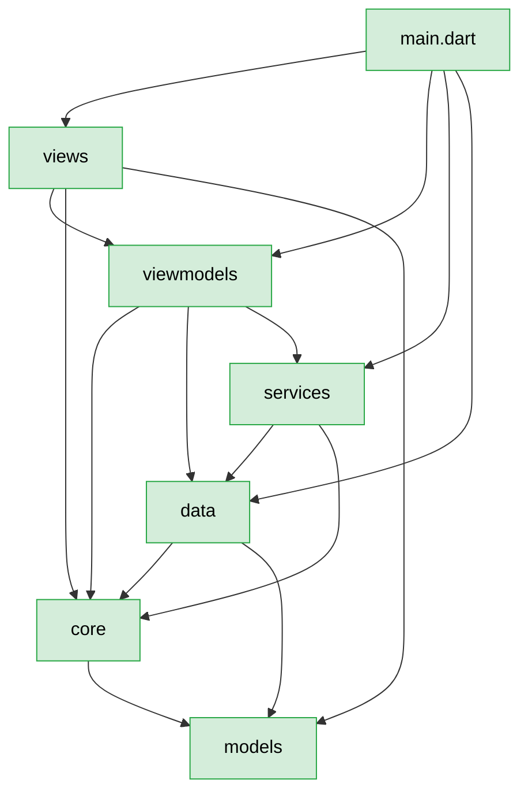

# Brooks-Lint Health Dashboard

**Mode:** Health Dashboard
**Scope:** `I:\Examples\dlaoshi_app` — Flutter 安卓版「D老师帮你办」，90 个提交、`lib` 156 个 .dart / 39,953 行、`test` 123 个 .dart / 25,167 行
**Composite Score:** 84/100
**Trend:** Stable at 84（上次 84）

结构骨架依旧稳（分层单向、零循环依赖、零 `core` → `flutter` 越界、98 个 core 文件全有同名测试），五门禁全绿。扣分仍集中在**界面层测试裸奔**和**跨模块重复实现**这两处，上一轮报告后这两项都没动。

| Dimension | Score | Top Finding |
|-----------|-------|-------------|
| Code Quality | — | 工作区干净，无 diff → 该维跳过（权重按规则再分配） |
| Architecture | 88/100 | 依赖方向全对，但 `core/writing.dart` 774 行、扇入 13，是唯一被 13 处 import 的模块 |
| Tech Debt | 85/100 | 三份近乎逐行相同的 `_appendRecord`；`_ErrorBar` 在 9 个页面各写一遍 |
| Test Quality | 76/100 | 22 个页面只有 3 个有测试；`test/views/` 3 个文件盖 22 个页面 |

## Module Dependency Graph

## Top Findings (max 5 across all dimensions)

### 🟡 Warning

**Test Obscurity（T1）— 22 个界面只有 3 个有测试**
Symptom: `lib/views/*.dart` 22 个文件，`test/views/*.dart` 只有 3 个（`production_run_test` / `production_setup_test` / `writing_panel_test`）。`backup_page`、`shadowing_page`、`golden_page` 等 19 个页面零测试。
Source: *Working Effectively with Legacy Code* — "测试是重构的安全网"；没有测试的代码改一行都要靠手工回归。
Consequence: 上一轮 review 在 `writing_panel.dart` 找到的「词块输入框吞分隔符」就是零测试区域的典型 bug —— 用户打不出第二个词块，代码审查看得出来，但没有任何自动化信号。同样的坑还在 19 个页面里。
Remedy: 每个页面补一条 smoke 用例（pump 出来 + 关键文案在 + 主按钮可点），约 10 行/个。已有 `useTallScreen` helper 和「ViewModel 用 `.value` 注入不 dispose」的套路可直接复用。

**Knowledge Duplication（R3）— 三份 `_appendRecord` 几乎逐行相同**
Symptom: `lib/viewmodels/writing_view_model.dart:277`、`lib/viewmodels/production_view_model.dart:400`、`lib/viewmodels/drill_sentence_view_model.dart:310` 三个 `Future<bool> _appendRecord(WritingRecord)` 的差异只有：production 多一句 `productionTaskOf(record)?.skipped != true`，drill 少了去重判断的 `counted` 变量。
Source: *Refactoring* — Duplicated Code；*The Pragmatic Programmer* — DRY。
Consequence: 「写记录怎么落库」这条规则现在有三份实现。上一轮已经因为要加 `ActivityCat.write` 同时改了三处；下次加「按文章归档」或「写失败重试」还要再改三遍，漏一处就是数据不一致。
Remedy: 抽 `lib/services/writing_ledger.dart`，签名 `Future<bool> appendWritingRecord({required LearningRepository repo, required List<WritingRecord> current, required WritingRecord record, required bool countActivity})`，三个 ViewModel 各自只传 `countActivity` 的判断。

**Knowledge Duplication（R3）— `_ErrorBar` / `_NoticeBar` 在 15 个地方各写一遍**
Symptom: `_ErrorBar` 出现在 9 个 views 文件（articles / backup / drill_sentence / golden / production / shadowing / study / vocab_browse / writing），`_NoticeBar` 在 6 个。每个都是 15–30 行的 `Container` + `colorScheme.errorContainer` / `secondaryContainer`。
Source: *Refactoring* — Duplicated Code。
Consequence: 调一次配色或加一个「错误可复制」按钮，要改 15 个文件；现在这几处样式已经开始漂移（`_NoticeBar` 有的带 close 按钮有的不带）。
Remedy: 提到 `lib/widgets/status_bar.dart` 导出 `StatusBar.error(...)` / `StatusBar.notice(...)`。注意 `lib/views/` 的私有类是刻意的分层约束，但 `lib/widgets/` 就是为这种共享 UI 存在的，不违反架构。

### 🟢 Suggestion

**Cognitive Overload（R1）— `core/writing.dart` 774 行、扇入 13**
Symptom: `lib/core/writing.dart` 774 行，含 35 个顶层符号（`ImitationTask` / `WritingFeedback` / `WritingIssue` / `WritingRecommendation` / `buildWritingFeedbackPrompt` / `parseWritingFeedbackDetailed` 等），被 13 处 import。全库扇入第一，第二名 `learning.dart` 是 12。
Source: *A Philosophy of Software Design* — "模块应该深而不宽"；774 行的文件让读者必须先扫完 35 个符号才知道要找的那个在哪。
Consequence: 想用 `parseWritingFeedback` 的人得先把整个批改协议读完；改 `WritingFeedback` 的字段会牵动 13 个 import 方。
Remedy: 按「协议 / 提示词 / 解析」拆三个文件（`writing_types.dart` 放数据结构、`writing_prompt.dart` 放两个 build、`writing_parse.dart` 放两个 parse），`writing.dart` 只留 re-export。参照 `golden.dart` / `golden_parse.dart` / `golden_exam.dart` 已经这么拆过，有现成先例。

**Accidental Complexity（R4）— `core/quiz.dart` 的 6 个顶层函数零消费者**
Symptom: `buildQuizQuestions` / `countQuestions` / `makeQuestion` / `isCorrect` / `isArticleKind` / `makeDictationQuestion` 在 `lib` 里 0 处调用（排除 `quiz.dart` 自身）。`quiz.dart` 只被 `drill_sentence.dart` import 一次，且只用了 `QuizQuestion` / `QuizKind` 两个类型。
Source: *The Pragmatic Programmer* — "不要为想象中的需求写代码"。
Consequence: 565 行的出题引擎 + 19 种题型 + 100 例测试，当前产品里没有任何入口能触发它（背单词走的是 `study_view.dart` 的释义四选一）。上一轮 review 已确认这是「整卷考试」链路未落地，不是接线漏了。它现在还占着 `check_core_tests` 的一个测试文件位。
Remedy: 两条路选一 —— 要么在 P6 之后真的接上「整卷 / 题型考试」入口，要么把 `buildQuizQuestions` 这一半标 `@visibleForTesting` 并在 `docs/PLAN.md` 记成「等考试功能再启用」。不要留着让下一个人以为是活代码。

---

## Recommendation

最该先动的是**测试维（76 分，全库最低）**：19 个无测试页面不是学术问题，上一轮就在 `writing_panel.dart` 抓到一个用户实际撞得上的 bug，而那片区域恰好零覆盖。补 19 条 smoke 用例的收益比任何重构都直接。

架构（88）和债务（85）本身不危险 —— 分层是真的干净（`data` → `views` 零 import、`core` → `flutter` 零 import、620 条依赖边零双向），扣分全在「重复」和「单文件过大」这两类可以机械消除的问题上。想深挖可以单独跑 `brooks-debt` 拿分优先级的重构路线图；`_appendRecord` 三合一大概半小时，`_ErrorBar` 提 `lib/widgets/` 大概一小时。

`quiz.dart` 那 565 行建议尽快定性 —— 悬着的「可能有用」比确定没用的代码更费维护心力。
