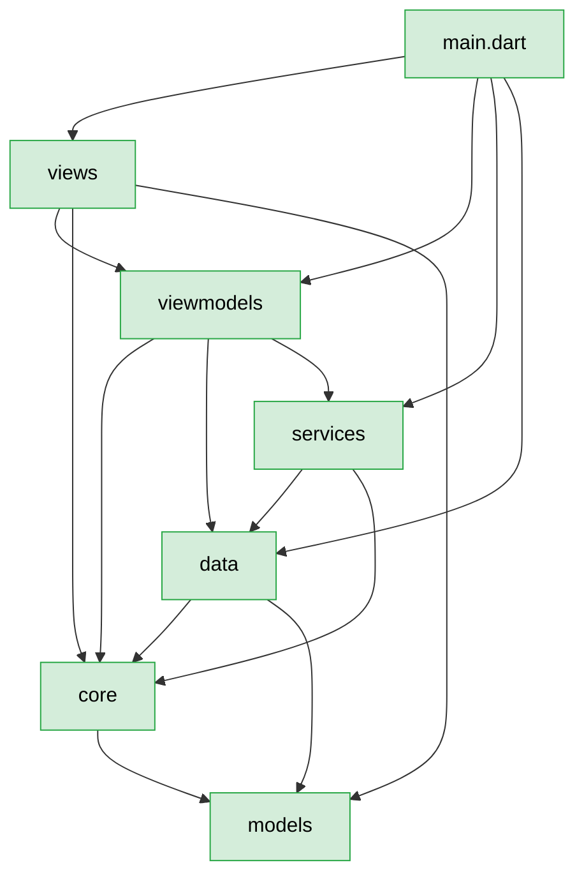

# Brooks-Lint Health Dashboard

**Mode:** Health Dashboard
**Scope:** `I:\Examples\dlaoshi_app` — Flutter 安卓版「D老师帮你办」，88 个提交、`lib` 156 个 .dart / 39,953 行、`test` 123 个 .dart / 25,167 行
**Composite Score:** 84/100

结构骨架很稳（分层单向、零循环依赖、零 `core` → `flutter` 越界、98 个 core 文件全有同名测试），扣分几乎全在**测试只盖了底层、界面层几乎裸奔**和**几个跨模块重复实现**上。

| Dimension | Score | Top Finding |
|-----------|-------|-------------|
| Code Quality | — | 工作区干净，无 diff → 该维跳过（权重按规则再分配） |
| Architecture | 88/100 | 依赖方向全对，但 `core/writing.dart` 一个文件被 11 处 import，扇入偏高 |
| Tech Debt | 85/100 | 三份几乎逐行相同的 `_appendRecord`；`_ErrorBar` 在 9 个页面各写一遍 |
| Test Quality | 76/100 | 22 个页面只有 3 个有测试；`test/views/` 3 个文件盖 22 个页面 |

## Module Dependency Graph

**单向性核实**（`tool/check_layers.dart` 通过，156 个源文件）：`data` → `views`/`viewmodels` 0 处；`core` → `package:flutter` 0 处；`views`/`widgets` → `package:sqflite` 0 处。**没有循环依赖**。

## Top Findings (max 5 across all dimensions)

### 🟡 Warning

**Test Obscurity — 界面层 22 个页面只有 3 个有测试**
Symptom: `lib/views/` 有 22 个 .dart，`test/views/` 只有 `production_run_test.dart`、`production_setup_test.dart`、`writing_panel_test.dart` 三个。`reader_page.dart`(603)、`study_page.dart`(649)、`golden_drill_view.dart`(602)、`golden_plan_view.dart`(589)、`production_setup.dart`(741) 全部无测试。整个 `test` 树 123 个文件里，`test/core` 占 97 个。
Source: *Working Effectively with Legacy Code* — "A test is a description of behavior; untested UI is behavior nobody can describe."
Consequence: 吸顶吸底、粘回 AI 结果、切句这类交互改一行就可能悄悄坏掉——它们在 widget 树上没有断言，`flutter analyze` 也看不出来。这次 HY4 时段的 P1 缺陷（词块输入框吞分隔符）就是活例子：**只有跑起来才看得见，静态检查全绿**。
Remedy: 优先给「有状态机」的页面补 smoke 测试，不必全覆盖：`study_page`（选词→判分→结算）、`reader_page`（切句→选词→存库）、`golden_drill_view`（填空→拼句→小结）。每个 2–3 例，断言关键文案与按钮存在即可，用现成的 `production_run_test.dart` 当模板。

### 🟡 Warning

**Knowledge Duplication — 三份 `_appendRecord` 各写一遍同样的落库口径**
Symptom: `lib/viewmodels/writing_view_model.dart:277`、`lib/viewmodels/production_view_model.dart:400`、`lib/viewmodels/drill_sentence_view_model.dart:310` 三个私有方法体几乎逐行相同：`hasSameWritingAttempt` 去重 → `addWritingRecord` → `_learningRepo.load()` → `data.writingHistory = writingRecordsToJson(next)` → 条件性 `addActivity(..., ActivityCat.write)` → `write(data, [writingHistory, activity])` → 更新 `_history`。差异只有两处：production 要判 `productionTaskOf(record)?.skipped != true`，drill 不去重（它自己 `_hasSameAttempt` 已收敛到同一个 core 函数）。
Source: *The Pragmatic Programmer* — DRY, "Every piece of knowledge must have a single, unambiguous, authoritative representation within a system."
Consequence: `writing_records` 是「先清后插」的表，这个「必须整段重写」的约束现在写在三处注释里。任何一处漏掉 `notifyListeners()` 或写错 section 列表，只有那条链路会悄悄丢记录——另外两条照常绿。
Remedy: 抽 `lib/services/writing_ledger.dart`：`Future<bool> appendRecord(WritingRecord, {required List<WritingRecord> history, required void Function(List<WritingRecord>) onHistory})`，把「去重 + 写两段 + 回传」收成一份。三个 ViewModel 各留一行调用，`counted` 的判断用回调参数表达。

### 🟡 Warning

**Change Propagation — `_ErrorBar` / `_NoticeBar` 在 9 个与 6 个页面里各写一份**
Symptom: `grep -l _ErrorBar lib/views` 命中 `articles_page` / `backup_page` / `drill_sentence_page` / `golden_page` / `production_page` / `shadowing_page` / `study_page` / `vocab_browse_page` / `writing_page` 共 9 个文件；`_NoticeBar` 命中 6 个。每份都是下划线私有类，样式一致（`errorContainer` 底 / `secondaryContainer` 底 + 关闭按钮），但改一次配色要改 15 处。
Source: *Refactoring* — "Divergent Change: one class is commonly changed in different ways for different reasons."
Consequence: 全局提示样式漂移是必然的——这次已经能看到细微差别（有的 `_NoticeBar` 有 `IconButton` 关闭、有的没有）。
Remedy: 提到 `lib/widgets/bars.dart` 做两个公开组件 `ErrorBar` / `NoticeBar`。这不算「提前抽象」：同样的结构已经重复 15 次，且它们零业务逻辑，纯样式。

### 🟢 Suggestion

**Cognitive Overload — `core/writing.dart` 774 行、被 11 处 import**
Symptom: 单文件 774 行，扇入 11（`grep -rl "/writing.dart'" lib` 命中 11 个文件），里面同时住着 `ImitationTask`、`WritingFeedback`、`WritingIssue`、`WritingRecommendation`、`buildImitationTaskPrompt`、`buildWritingFeedbackPrompt`、`parseWritingFeedbackDetailed`。文件已经用 `export` 把 `writing_json.dart` / `writing_record.dart` / `writing_error_rules.dart` 挂出来了，说明作者自己也意识到该拆。
Source: *A Philosophy of Software Design* — "Deep modules hide complexity; but a module that does everything is not deep, it is wide."
Consequence: 想改批改提示词的人必须读完任务构造与解析逻辑；774 行还没到 800 行的门禁线，所以门禁不会提醒它。
Remedy: 按职责拆三块——`writing_task.dart`（`ImitationTask` + `buildImitationTaskPrompt` + `parseImitationTask`）、`writing_feedback.dart`（`WritingFeedback` 家族 + 提示词）、`writing_parse.dart`（解析与宽容守卫）。`writing.dart` 只留 `export` 变成门面，调用方一行不用改。

### 🟢 Suggestion

**Test Brittleness — 9 处真实延时与 2 处定时器推进靠「多等几轮」**
Symptom: `grep "Future<void>.delayed" test` 命中 9 处；`test/widget_test.dart` 收尾用 `for (var round = 0; round < 6; round++) { runAsync(delay 100ms); pump(500ms) }` 硬等；`test/viewmodels/shadowing_view_model_test.dart` 里 `startRecording` 之后必须 `delayed(120ms)` 才能让 `TakeTracker` 听到声音。
Source: *xUnit Test Patterns* — "Slow Tests / Erratic Tests: waiting for real time is the classic source of both."
Consequence: 慢（全量 50 秒）且偶发——这条 `widget_test` 在修之前**两跑一挂**，靠加轮次压下去的，不是真解决。机器更慢或 CI 更挤的时候还会复现。
Remedy: 把 `TakeTracker` 的「时间」改成注入的 `Duration` 累加（现在 `_tick` 里 `_elapsedMs += levelPushMs`，已经是假的，问题在 ViewModel 用 `Timer.periodic` 驱动）。给 `ShadowingViewModel` 加一个可注入的 `Stream<Duration>? ticks`，测试直接推帧；`widget_test` 那 6 轮则换成等 `bootstrap` 的 Future 完成。

## Recommendation

先补**界面层的 smoke 测试**（Test Quality 76 是最低的一维，也是这次 P1 缺陷能溜进去的原因）——不用追求覆盖率，只挑三个有状态机的页面各写 2–3 例，成本低、拦得住「改了看不见」的回归。紧接着做 `_appendRecord` 与 `_ErrorBar`/`_NoticeBar` 两处收敛：它们都是**已经重复了 3 次和 15 次**的确定性重复，不是猜想的抽象，抽出来风险极低。`core/writing.dart` 的拆分可以放到下一轮，它目前没到门禁线、也不阻塞任何事。

架构维度 88 分是真实水平：`check_layers` 全绿、零循环、`core` 完全不碰 Flutter，这个底盘比大多数同类项目干净。真正要警惕的是**测试的地基只打到 core 层**——25,167 行测试里 97/123 个文件都在 `test/core`，而用户实际点的是那 22 个页面。
