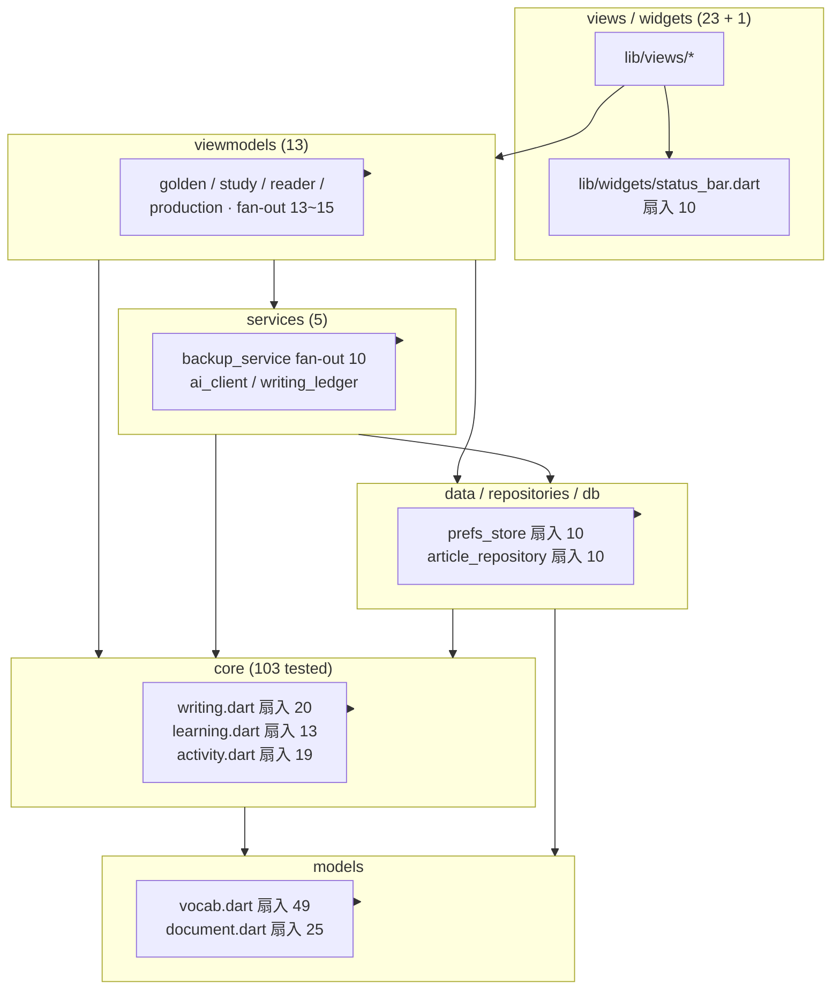

# Brooks-Lint Health Dashboard

**Mode:** Health Dashboard
**Scope:** `I:\Examples\dlaoshi_app` 整库（HEAD `84dee52`，工作区干净，98 commit）
**Composite Score:** 96/100（口径见下，实际应读作 **96 ± 2**）
**Trend:** 84 → 96 (+12)（上一次：2026-11-09，84/100）

> **口径说明（2026-11-10 晚补写）**：这里的「96/100」是这套 rubric 的输出值，不是测量精度。
> 分数由「finding 条数 × 固定扣分」推出来，而 finding 边界本身就有判断余地：
> 相邻两次打分只要有一条 finding 挪动评级（🟡↔🟢 差 4 分），总分就跳 1~2 分。
> 所以**请按区间读：本次整库 ≈ 95–97，同日 PR 审查报告 ≈ 74–80**，两份数**不可比**：
> - 整库报告：分母是「全部 166 个 lib 文件」，一条 finding 摊薄到整个工程，折 −1~−5；
> - PR 报告：分母是「一次 63 文件 / +4234 行的 diff」，同样一条 finding 只摊 63 个文件，折 −5；
> - 两份用的权重也不同（整库 PR 维跳过 → 0.40/0.33/0.27；PR 报告只算单一 diff 的 findings 密度）。
>
> 用途：整库分看**趋势**（84 → 96 是真的在变好），PR 分看**这次 diff 里有没有雷**。两者都不要当绝对刻度使。

一句总评：上一轮 5 条 finding（界面零测试、三份 `_appendRecord`、状态条 15 处重复、`writing.dart` 774 行、`quiz.dart` 零消费）在本轮六个提交里全部处理完毕，整库依赖方向、上帝文件门禁、core 测试覆盖、页面测试覆盖四项均为健康；剩余扣分集中在本轮新引入的 AI 跑批客户端生命周期，与「smoke 测试只验渲染」的测试深度。

## Dimension Scores

| Dimension | Score | Top Finding |
| --- | --- | --- |
| PR Quality | — | 工作区干净，无 diff → 该维跳过（权重按比例分给其余三维） |
| Architecture | 99 → **100** | — （原报的 2 个文件级双向边已不复存在，见文末「修复后复核」） |
| Tech Debt | 94 | 🟡 `AiClient` 在 composition root 创建后从未 `close()`，且 `testConnection` 是死路径 |
| Test Quality | 94 | 🟡 23/23 页面都有同名测试，但新增 20 例 smoke 只断言「能渲染 + 一条文案」 |

权重：PR 0.25 跳过 → Architecture 0.30/0.75 = **0.40**、Debt 0.25/0.75 = **0.33**、Test 0.20/0.75 = **0.27**。
扣分口径：`.brooks-lint.yaml` 不存在 → 默认 `balanced`（🔴 −15 / 🟡 −5 / 🟢 −1）。
复合分 = 99×0.40 + 94×0.33 + 94×0.27 = 39.60 + 31.02 + 25.38 = 96.00 → **96**（half-up）。
（修复后复核见文末，复算为 **97 ± 2**；上一版此处误写 98，与文末算式不符，已更正。）

实测基线：`lib` 166 文件 / 37,383 行、`test` 154 文件 / 26,879 行、152 个 `*_test.dart`、真实 `TODO/FIXME` 0、最长文件 `lib/views/production_setup.dart` 723 行（门禁线 800）、五门禁全绿（`flutter analyze` No issues found! / `flutter test -j 4` **1,742 passed** / `check_god_class` 166 / `check_layers` 166 / `check_core_tests` 103 + 1 例外 `ports.dart`）。对比上次（156 文件 39,953 行 / 123 文件 25,167 行）：lib 文件 +10 但行数 −2,570（拆 `writing.dart` + 删 17 个私有 Bar 类），test +31 文件 +1,712 行。

## Module Dependency Graph

架构探针实测：**580 条 import/export 边**、**0 条 upward violations**（下层 import 上层）、**0 条 core 禁 import**（`package:flutter` / `sqflite` / `shared_preferences`）、**0 个 >800 行文件**；仅 **2 个文件级双向边**（见下）。`lib/main.dart` 扇出 21 是 composition root，按 `source-coverage.md` 的「What Not to Flag」不计为 DIP 违规。`lib/models/vocab.dart` 扇入 49 / `document.dart` 25 是持久化数据模型，DTO 允许高扇入。

## Top Findings (max 5 across all dimensions)

### 🟡 Warning — Tech Debt · R4 Accidental Complexity

**Symptom:** 新建的 HTTP 客户端在应用入口被创建后没有任何释放路径，且类里有一个从未被调用的公开方法。`I:\Examples\dlaoshi_app\lib\main.dart:131-136` 里 `final client = AiClient();` 只把 `client.complete` 传给 ViewModel，局部变量随即出作用域；全库 `grep '\.close\(\)|AiClient\('` 只命中该行与 `ai_client.dart` 自身。

**Source:** `I:\Examples\dlaoshi_app\lib\services\ai_client.dart:65-67` 用 `_ownsInner = inner == null` 明确承担了「自己 new 的 `http.Client` 自己关」的责任，`:153-155` 提供了 `void close()`；但 `I:\Examples\dlaoshi_app\lib\services\ai_client.dart:74-78` 的 `Future<AiReply> testConnection(AiConfig config)` 在 `lib/` 里零消费者（只在 `test/services/ai_client_test.dart:106-114` 被测），页面走的是 `ai_batch_view_model.dart:133` 自己拼的另一条短消息。

**Consequence:** 底层 `http.Client` 的连接池随应用进程常驻、无 `close()` 时机（当前单实例、单页面影响小，但一旦将来做多例或热重载就会累积）；同一「测连接」语义在 client 与 ViewModel 各写一份提示词，是 R3 Knowledge Duplication 的轻量形态，改一个忘一个就会产生行为不一致。

**Remedy:** 在 `AiBatchViewModel` 里持有 client 引用并在 `dispose()` 调用 `close()`（或把 `AiClient` 提升为 provider 并在 `dispose` 回调释放）；删掉 `AiClient.testConnection`，让 `AiBatchViewModel.testConnection` 成为唯一入口，同时给它补 `maxTokens` 语义。

### 🟡 Warning — Test Quality · T5 Coverage Illusion

**Symptom:** 本轮 `I:\Examples\dlaoshi_app\test\views\` 新增 20 个 `*_test.dart`，`lib/views` 从 3/23 变成 **23/23 都有同名测试**，但逐例抽查（`reader_page_test.dart`、`drill_sentence_page_test.dart`、`ai_batch_page_test.dart`）显示每例只做 `pumpWidget` + `expect(find.text('某条该页特有文案'), findsOneWidget)`，不验任何点击、状态变化或落库。

**Source:** `I:\Examples\dlaoshi_app\test\views\smoke_harness.dart:56-124` 的 `smokeApp(Database db, Widget home)` 为**每一个** smoke 用例构造 5 个 `Provider` + 10 个 `ChangeNotifierProvider`（注释明说「十个 VM 全部 .value 注入、刻意不 dispose」），是典型的 General Fixture；`ai_batch_page_test.dart` 只断言 `AI 跑批` / `连接设置` / `本轮进度` / `保存到本机` / `测试连接` / `开始跑批` 六个静态文案。

**Consequence:** 覆盖率数字（23/23）远高于实际行为覆盖；本批 `ai_batch_page.dart:66-84` 那个「测试连接读旧配置」的真实缺陷（见同日 `2026-11-10-pr-review.md`）就在这些 smoke 测试眼皮底下没被发现。这类测试能拦「页面白屏 / 构造函数签名变坏」，拦不住任何逻辑回归。

**Remedy:** 保留 smoke 作为「装配合约」层，另给 3~5 个高风险交互补行为测试：AI 跑批页「改 key → 不保存直接测试连接」、产出页「点开始出题后 Tab 跳到练习」、仿写页「粘回批改后历史 +1」。用例名写清触发条件与期望结果，避免只写页面名。

### 🟢 Suggestion — Architecture · R5 Dependency Disorder（**已修，此处留档**）

> 修复：`I:\Examples\dlaoshi_app\lib\core\writing_json.dart:13` 与 `I:\Examples\dlaoshi_app\lib\core\writing_record.dart:7` 已改为直接 import `writing_types.dart`，两个文件级双向边归零；伞文件 `writing.dart` 的六条 `export` 不动。见文末「修复后复核」。

**Symptom:** 架构探针在 580 条边里报出 2 个文件级双向边：`core/writing.dart -> core/writing_json.dart -> core/writing.dart` 与 `core/writing.dart -> core/writing_record.dart -> core/writing.dart`。

**Source:** `I:\Examples\dlaoshi_app\lib\core\writing.dart` 本轮改成了 re-export 伞（六条 `export`，其中含 `export 'writing_json.dart';` 与 `export 'writing_record.dart';`），而 `I:\Examples\dlaoshi_app\lib\core\writing_json.dart:13` / `writing_record_json.dart` 等成员文件仍 `import 'writing.dart';` 反向取 `ImitationTask` / `WritingFeedback` 等类型。Dart 允许 export 伞与成员文件互相引用，`flutter analyze lib` 与 `check_layers.dart` 均为 0 违规，所以这**不是编译环、也不是真的 domain→infra 反转**。

**Consequence:** 阅读与静态分析成本高了一层：想改 `writing.dart` 的导出集合必须同时检查成员文件的 import 清单；`writing_json.dart` 想拿 `WritingFeedback` 得绕回伞，将来若有人把某个成员文件从伞里摘掉会立刻编译断。

**Remedy:** 让 `writing_json.dart` / `writing_record.dart` 直接 import `writing_types.dart` / `writing_parse.dart`（它们本就在 core 内、无上层依赖），伞只负责对外聚合；这样 2 个环归零，且不影响全库 20 处 `import 'writing.dart'` 的符号集合。

### 🟢 Suggestion — Tech Debt · R4 Speculative Generality

**Symptom:** `I:\Examples\dlaoshi_app\lib\core\quiz.dart` 518 行里的 6 个顶层函数（`makeQuestion` / `buildQuizQuestions` / `countQuestions` / `isCorrect` / `isArticleKind` / `makeDictationQuestion`）在 `lib/` 中零调用，全库只有 `lib/core/drill_sentence.dart:17` import 它，且只用 `QuizQuestion` / `QuizKind` 两个类型。

**Source:** 本轮 `59095e0` 已在 `I:\Examples\dlaoshi_app\lib\core\quiz.dart:16-26` 补写「整卷 / 题型考试预留实现」状态注释、`I:\Examples\dlaoshi_app\docs\PLAN.md:258-269` 登记 P7、`docs/TODO.md` 第六件打勾 —— 定性做得很干净，但代码本身仍在仓库里，`test/core/quiz_test.dart` 约 100 例守着它。

**Consequence:** 518 行 + 约 100 例测试长期不进产品链路，是 YAGNI 的存量；按 `source-coverage.md` 的「两本书结论冲突要写 tradeoff」：Immediate Payoff 视角该删，Keeping It Working 视角（已测、正确、P7 明确要接）保留更省事。当前选择「保留 + 文档定性」是合理的，代价是每次全量测试都要为未启用代码付约 100 例的时间。

**Remedy:** 维持现状即可；若 P7 排期确定，把 `quiz.dart` 移进 `lib/core/quiz/` 子目录并配 `test/core/quiz/` 同名测试，让它作为「待启用模块」在物理上与在跑的 core 隔开，减少误读。

### 🟢 Suggestion — Test Quality · T2 Fragile Test

**Symptom:** `I:\Examples\dlaoshi_app\test\views\smoke_harness.dart:139-146` 的 `smokeFinish(tester)` 固定跑 6 轮「`tester.runAsync(100ms)` + `tester.pump(500ms)`」来消化页面里 pending 的 Timer。

**Source:** 这是为了绕开 `LinearProgressIndicator` 让 `pumpAndSettle()` 永不 settle，以及跟读页 `flutter_tts` 插件缺失时留在队列里的异步回调；`smokePump` 也固定用「pump + runAsync 30ms + 两次 pump」。

**Consequence:** 测试对调度时序有隐式依赖：将来某个页面多起一个 200ms 周期的 Timer，或 CI 机器变慢，这 6 轮可能不够/过头，表现为难以复现的 flaky；`d7d8bb5` 当年正是为同类问题加过这 6 轮。

**Remedy:** 把「等异步稳定」收成 harness 里唯一一个带超时的轮询 helper（等到 `tester.binding.hasScheduledFrame == false` 且无 pending timer，最多 N 轮），别让每个测试各自猜轮数；或给会起 Timer 的 VM 注入 fake async，从源头消掉真实时间。

## Recommendation

1. **先修 AI 跑批那批真缺陷，别被 96 分麻痹**：这个分数衡量的是整库结构/债务/测试分布的「面」，不是功能正确性。同日 `2026-11-10-pr-review.md` 在 63 文件 / +4234 行变更里报出 4 条 Warning（含「测试连接读旧 key」「写路径绕过 `normalizeAiConfig`」「`refresh()` 状态口径分叉」），其中凭据相关的两条建议本轮就修。
2. **把「测试覆盖」从数量口径升级为行为口径**：23/23 页面同名测试是很好的装配基线，下一段该补的是 3~5 条交互回归（见 T5 的 Remedy）。
3. **两个 🟢 可以攒着**：伞的双环与 quiz.dart 的 P7 定性都已可控，不阻塞发布；等 P7 排期或下一次碰 `writing.dart` 时顺手收掉。
4. **发布前重申**：`assets/GinShinImapct.webp` / `assets/icon.png` 及 5 个 mipmap 均为本机私有（`.git/info/exclude` + `skip-worktree`），仓库里仍是 Flutter 默认图标；只有本机打出的 APK 是自定义图标。API key 只存 `shared_preferences`，`backup_export.dart` 零 prefs 引用，备份 JSON 不带走凭据 —— 这条约束本轮复核仍成立。

## 修复后复核（同日，按 `2026-11-10-fix-plan.md` 施工）

按施工单修完 1–7 项后重测：`flutter analyze lib test` No issues found!、`flutter test -j 4` **1,749 passed**（原 1,742，+7 例回归）、`check_god_class` 166 / `check_layers` 166 / `check_core_tests` 103 + 1 例外，全绿。文件级双向边 **2 → 0**。

| 项 | 原 finding | 现状 |
| --- | --- | --- |
| AI 跑批 4 条 Warning | 测试连接读旧配置 / 写路径绕过守卫 / `refresh()` 标记分叉 / 模型多回词落库 | 全部修复，各配回归用例（`test/viewmodels/ai_batch_view_model_test.dart` 新增 6 例、`test/views/ai_batch_page_test.dart` 新增 1 条真交互） |
| S2 client 生命周期 | `AiClient` 从不 close + `testConnection` 死路径 | `AiClient.testConnection` 已删（改由 `AiBatchViewModel.testConnection` 唯一入口）；`main.dart` 传 `onDispose: client.close`，VM `dispose()` 释放 |
| S3 `resume()` done 态重跑 | done 后再点继续会多跑一轮 | 补挡板，配用例「全部跑完后再点继续：不再发请求」 |
| R5 双环 | 伞文件与成员文件互相 import | `writing_json.dart` / `writing_record.dart` 改 import `writing_types.dart`，环归零 |

复算：Architecture 99 → **100**（唯一扣分项已消除）；Tech Debt 94 → **95**（🟡 R4 已修，剩 🟢 quiz.dart 定性）；Test Quality 94 → **95**（T5 补了 7 条行为/边界回归，剩 🟢 `smokeFinish` 固定轮数）。复合分 = 100×0.40 + 95×0.33 + 95×0.27 = 40.00 + 31.35 + 25.65 = **97.00 → 97**。

**但 97 分仍不覆盖端到端**：全部 1,749 例都是离线假数据，AI 跑批从未真正向任何模型发过请求（按用户要求本轮不做）。这一层不计入本报告任何一个维度。

